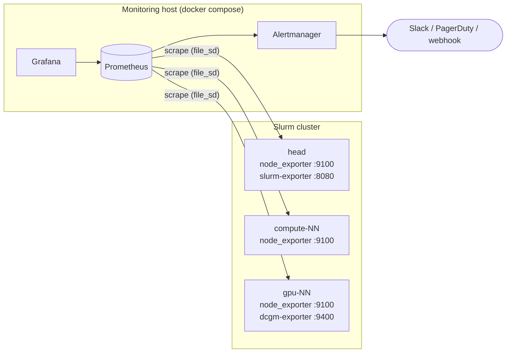

# slurm-observability

[](https://github.com/Engdarwish2019/slurm-observability/actions/workflows/ci.yml)


Monitoring and alerting for Slurm HPC clusters with CPU and NVIDIA GPU nodes. A Docker Compose
stack runs Prometheus, Alertmanager and Grafana; Ansible installs the exporters on the cluster.
Every alert rule has a unit test that runs in CI with `promtool`.

## Architecture



## What you get

**Dashboards** (provisioned automatically, folder *HPC*):

| Dashboard | Panels |
|---|---|
| Slurm cluster overview | CPU allocation, running and pending jobs, nodes down/drained, node state history, scheduler queue, CPU, memory, `/shared` space and network per node |
| GPU nodes | Slurm GPU allocation next to real DCGM utilisation, temperature, framebuffer memory, power, XID errors |

**Alerts** (`prometheus/rules`):

| Alert | Severity | Why it matters |
|---|---|---|
| `NodeExporterDown` | critical | Node unreachable; inhibits the node's other alerts |
| `NodeFilesystemAlmostFull` | warning | Jobs fail when scratch or `/shared` fills up |
| `NodeMemoryPressure`, `NodeSystemdUnitFailed` | warning | Early signs of OOM kills and broken services |
| `SlurmExporterDown` | critical | No scheduler visibility; often slurmctld itself is down |
| `SlurmNodesDown`, `SlurmNodesDrained` | warning / info | Lost capacity, with the `sinfo -R` hint in the alert |
| `SlurmJobsPendingWithIdleCPUs` | warning | Jobs wait while CPUs are idle: a limit, reservation or config issue, not missing capacity |
| `SlurmClusterSaturated` | info | Capacity planning signal |
| `GPUXidError` | critical | Driver, memory or hardware fault: drain the node |
| `GPURowRemapFailure` | critical | The GPU ran out of spare memory rows: keep it drained, RMA |
| `GPUUncorrectableMemoryError` | warning | A memory row was remapped after an uncorrectable error: reset the GPU once jobs finish |
| `GPUHighTemperature` | warning | Thermal throttling |
| `GPUsAllocatedButIdle` | info | GPUs held by jobs but under 10% used: wasted, expensive capacity |

Recording rules `slurm:cpu_utilisation:ratio` and `slurm:gpu_utilisation:ratio` feed both the
dashboards and the alerts.

## Quick start

```bash
# 1. Monitoring stack (binds to 127.0.0.1 only)
make up                       # creates secrets/grafana_admin_password, then docker compose up
open http://127.0.0.1:3000    # user: admin, password: cat secrets/grafana_admin_password

# 2. Exporters on the cluster (same inventory groups as ansible-hpc-roles)
cd ansible
ansible-playbook playbooks/exporters.yml

# 3. Scrape targets generated from the same inventory
ansible-playbook playbooks/targets.yml   # writes prometheus/targets/*.yml
curl -X POST http://127.0.0.1:9090/-/reload
```

Exporters accept connections only from `monitoring_server` (firewalld rich rules), run as
unprivileged users, and use hardened systemd units (`NoNewPrivileges`, `ProtectSystem=strict`).
The node_exporter download is checked against the official `sha256sums.txt`.

## Tests

```bash
make check   # promtool check config + amtool check-config
make test    # promtool test rules: node, slurm and gpu rule tests
```

The tests in [`prometheus/tests`](prometheus/tests) feed synthetic series into the rules and
assert exactly which alerts fire, when, and with which labels and annotations. For example, the
Slurm test checks that 120 pending jobs with 10% CPU allocation fire
`SlurmJobsPendingWithIdleCPUs` after 30 minutes and not before.

## CI

| Job | Checks |
|---|---|
| promtool / amtool | Config validation and alert unit tests |
| dashboards / compose | Dashboard JSON structure, `docker compose config` |
| yamllint / ansible-lint | YAML style, Ansible production profile |
| security | `gitleaks`, Trivy misconfiguration scan |

## Exporters used

| Exporter | Where | Source |
|---|---|---|
| node_exporter | all nodes | [prometheus/node_exporter](https://github.com/prometheus/node_exporter) |
| prometheus-slurm-exporter | controller | [vpenso/prometheus-slurm-exporter](https://github.com/vpenso/prometheus-slurm-exporter), built from a pinned tag |
| dcgm-exporter | GPU nodes | [NVIDIA/dcgm-exporter](https://github.com/NVIDIA/dcgm-exporter) (DCGM 4), Podman with CDI |

GPU nodes run **one DCGM host engine** (`nvidia-dcgm`, installed by the `nvidia_gpu` role in
[ansible-hpc-roles](https://github.com/Engdarwish2019/ansible-hpc-roles)). dcgm-exporter reads from
it (`--remote-hostengine-info localhost:5555`) instead of starting a second, embedded engine, so
the exporter, `dcgmi diag` and the Slurm node health check all see the same GPU state and the
profiling counters are not fought over. Set `dcgm_exporter_hostengine: ""` for the embedded engine
on nodes without one.

## Related projects

- [ansible-hpc-roles](https://github.com/Engdarwish2019/ansible-hpc-roles): builds the Slurm cluster this stack monitors.
- [slurm-aws-terraform](https://github.com/Engdarwish2019/slurm-aws-terraform): the same cluster on AWS.

## License

MIT
